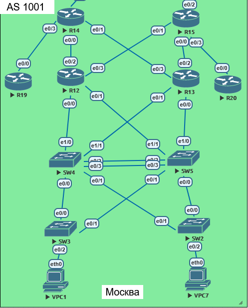

# Настроика OSPF в офисе Москва, разделить сеть на зоны и настроить фильтрацию между зонами.
##  Задание:

    1. Маршрутизаторы R14-R15 находятся в зоне 0 - backbone.
    2. Маршрутизаторы R12-R13 находятся в зоне 10. Дополнительно к маршрутам должны получать маршрут по умолчанию.
    3. Маршрутизатор R19 находится в зоне 101 и получает только маршрут по умолчанию.
    4. Маршрутизатор R20 находится в зоне 102 и получает все маршруты, кроме маршрутов до сетей зоны 101.
  

## Топология:
- **AS 1001**: Москва
  

## Адресация: Устройств Используемых в данном Примере

#### 1. Таблица адресации сетевых устройств "Москва (AS 1001)":
| Устройство    | Интерфейс    | IP-адресс          |
|--------------:|:-------------|-------------------:|
| R12           | loopback     | 10.21.37.2/32      | 
| R12           | e0/0.21      | 10.21.13.241/30    | 
| R12           | e0/1.24      | 10.21.13.129/26    | 
| R12           | e0/1.11      | 10.21.13.193/27    | 
| R12           | e0/2.22      | 10.21.13.1/26      | 
| R12           | e0/3.23      | 10.21.13.65/26     | 
| R13           | loopback     | 10.21.37.3/32      | 
| R13           | e0/0.24      | 10.21.13.130/26    | 
| R13           | e0/1.21      | 10.21.13.245/30    | 
| R13           | e0/1.11      | 10.21.13.194/27    | 
| R13           | e0/2.22      | 10.21.13.2/26      | 
| R13           | e0/3.23      | 10.21.13.66/26     | 
| R14           | loopback     | 10.21.37.4/32      | 
| R14           | e0/0.22      | 10.21.13.3/26      | 
| R14           | e0/1.23      | 10.21.13.67/26     | 
| R14           | e0/2.21      | 10.21.13.233/30    | 
| R14           | e0/3.101     | 10.21.13.225/30    | 
| R15           | loopback     | 10.21.37.5/32      | 
| R15           | e0/0.22      | 10.21.13.4/26      | 
| R15           | e0/1.23      | 10.21.13.68/26     | 
| R15           | e0/2.21      | 10.21.13.237/30    | 
| R15           | e0/3.102     | 10.21.13.229/30    | 
| R19           | loopback     | 10.21.37.6/32      | 
| R19           | e0/0.101     | 10.21.13.226/30    | 
| R20           | loopback     | 10.21.37.7/32      | 
| R20           | e0/0.102     | 10.21.13.230/30    | 
| SW2           | Vlan 37      | 10.37.1.2/24       | 
| SW2           | Vlan 21      | 10.21.13.77/26     | 
| SW3           | Vlan 37      | 10.37.1.3/24       | 
| SW3           | Vlan 24      | 10.21.13.67/26     | 
| SW4           | Vlan 37      | 10.37.1.4/24       | 
| SW5           | Vlan 37      | 10.37.1.5/24       | 
| VPC1          | Vlan 11      | 10.21.13.195/27    | 
| VPC7          | Vlan 11      | 10.21.13.196/27    |  

##  Архитектура и примененные механизмы:

  - Area 0 (Backbone): Соединяет транзитные узлы (Китрон R22, Ламас R21) и пограничные роутеры Москвы ([R14], [R15]).
  - Area 10 (Normal): Внутренняя сеть Москвы ([R12], [R13]). Получает полные маршруты и маршрут по умолчанию.
  - Area 101 (Totally Stubby): Изолированная зона ([R19]). Получает только маршрут по умолчанию.
  - Area 102 (Normal + Filter): Зона [R20]. Получает все маршруты, кроме сетей зоны 101.

##  Конфигурации:  
    
  ### Иерархическая адресация:
   1. Каждый регион получил уникальный третий октет (Москва 13, Китрон 11, Ламас 12). Изменение адресного пространства

          ip address 10.21.13.67 255.255.255.192   

  ### Инжекция маршрута по умолчанию:
   1. Команда default-information originate always metric 10 на ABR (R14, R15).
   2. Параметр always гарантирует анонс дефолтного маршрута даже при отсутствии его в RIB.

          router ospf 1   
          router-id 10.21.37.5   
          default-information originate always metric 10   

  ### Фильтрация маршрутов (Area 102):
   1. На R15 создан ip prefix-list BLOCK_AREA101, запрещающий Loopback R19 (10.21.37.6/32).
   2. Применен через area 102 filter-list prefix BLOCK_AREA101 out. R20 не знает о существовании R19.

          router ospf 1   
          router-id 10.21.37.5   
          area 102 filter-list prefix BLOCK_AREA101 out   

          ip prefix-list BLOCK_AREA101 seq 5 deny 10.21.37.6/32   
          ip prefix-list BLOCK_AREA101 seq 10 permit 0.0.0.0/0 le 32   

  ### Totally Stubby Area (Area 101):
   1. Команда area 101 stub no-summary на ABR (R14) и внутреннем роутере (R19).
   2. Блокирует LSA типов 3, 4 и 5. R19 видит в таблице маршрутизации только O*IA 0.0.0.0/0.   

          router ospf 1   
          router-id 10.21.37.4   
          area 101 stub no-summary   
        
  

  

[R12]: conf/base_conf12.md 
[R13]: conf/base_conf13.md  
[R14]: conf/base_conf14.md 
[R15]: conf/base_conf15.md  
[R19]: conf/base_conf19.md 
[R20]: conf/base_conf20.md  

