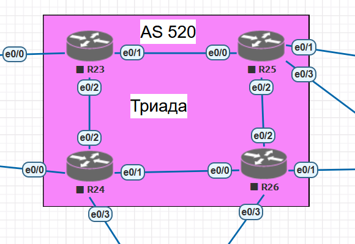

# Настройка протокол IS-IS для IPv4 и IPv6 в ISP Триада.
##  Задание:

 1. Настроите IS-IS в ISP Триада.
 2. R23 и R25 находятся в зоне 2222.
 3. R24 находится в зоне 24.
 4. R26 находится в зоне 26.
  

## Топология:
- **AS 520**: Триада
  

## Адресация: Устройств Используемых в данном Примере

#### Таблица адресации сетевых устройств "Триада (AS 520)":
| Устройство    | Интерфейс    | IP-адресс          |
|--------------:|:-------------|-------------------:|
| R23           | loopback     | 10.21.37.13/32     | 
| R23           | e0/0.23      | 10.21.11.13/30     | 
| R23           | e0/1.22      | 10.21.16.5/30      | 
| R23           | e0/2.21      | 10.21.16.10/30     | 
| R24           | loopback     | 10.21.37.14/32     | 
| R24           | e0/0.23      | 10.21.12.9/30      | 
| R24           | e0/1.22      | 10.21.16.21/30     | 
| R24           | e0/2.21      | 10.21.16.9/30      | 
| R24           | e0/3.24      | 10.21.16.13/30     | 
| R25           | loopback     | 10.21.37.15/32     | 
| R25           | e0/0.22      | 10.21.16.6/30      | 
| R25           | e0/1.23      | 10.21.16.42/30     | 
| R25           | e0/2.24      | 10.21.16.25/30     | 
| R25           | e0/3.21      | 10.21.16.34/30     | 
| R26           | loopback     | 10.21.37.16/32     | 
| R26           | e0/0.22      | 10.21.16.22/30     | 
| R26           | e0/1.23      | 10.21.16.38/30     | 
| R26           | e0/2.24      | 10.21.16.26/30     | 
| R26           | e0/3.21      | 10.21.16.45/30     |  

## 1. Планирование адресации и NET

В IS-IS используется адрес **NET** (Network Entity Title) для идентификации маршрутизатора и его зоны. System ID в данной схеме сформирован методом BCD-кодирования из IPv4-адреса Loopback-интерфейса (`10.21.37.X` → `0100.2103.70XX`).

| Устройство | Зона (Area) | Loopback (IPv4)  | NET адрес                   |
|:-----------|:------------|:-----------------|:----------------------------|
|   [R23]    | `2222`      | `10.21.37.13/32` | `49.2222.0100.2103.7013.00` |
|   [R24]    | `24`        | `10.21.37.14/32` | `49.0024.0100.2103.7014.00` |
|   [R25]    | `2222`      | `10.21.37.15/32` | `49.2222.0100.2103.7015.00` |
|   [R26]    | `26`        | `10.21.37.16/32` | `49.0026.0100.2103.7016.00` |

## 2. Архитектурные решения

1. **`is-type level-2-only`**: Сеть "Триада" является ядром провайдера (Core). Поскольку маршрутизаторы находятся в разных зонах (2222, 24, 26), использование чистого Level-2 объединяет их в единую плоскую магистраль. Это предотвращает неоптимальную маршрутизацию (suboptimal routing), характерную для Level-1, и экономит ресурсы CPU/RAM (не нужно хранить две LSDB).
2. **`metric-style wide`**: Включает 24-битные метрики (до 16 777 215). Это современный стандарт (Best Practice), необходимый для корректной работы в больших сетях и поддержки Traffic Engineering (TE).
3. **`log-adjacency-changes`**: Включает логирование изменений состояния соседства в syslog, что критически важно для мониторинга и диагностики сбоев (flapping).
4. **Имя процесса**: Использован тег `TRIADA` для явной идентификации процесса IS-IS.

### Пример настройки на R23 (Area 2222)

      hostname R23
      !
      interface Loopback0
      ip address 10.21.37.13 255.255.255.255
      ip router isis TRIADA
      !
      interface Ethernet0/0.23
      encapsulation dot1Q 23
      ip address 10.21.11.13 255.255.255.252
      ip router isis TRIADA
      !
      interface Ethernet0/1.22
      encapsulation dot1Q 22
      ip address 10.21.16.5 255.255.255.252
      ip router isis TRIADA
      !
      interface Ethernet0/2.21
      encapsulation dot1Q 21
      ip address 10.21.16.10 255.255.255.252
      ip router isis TRIADA
      !
      router isis TRIADA
      net 49.2222.0100.2103.7013.00
      is-type level-2-only
      metric-style wide
      log-adjacency-changes

      
## 4. Верификация и тестирование

После применения конфигурации были выполнены следующие проверки (на примере маршрутизатора **R26**) для подтверждения корректной работы протокола.

### 1. Проверка соседств (Adjacencies)

**Команда:** `show isis neighbors`

      R26# show isis neighbors
      Tag TRIADA:
      System Id      Type Interface   IP Address      State Holdtime Circuit Id
      R24            L2   Et0/0.22    10.21.16.21     UP    29       R26.01                                                          
      R25            L2   Et0/2.24    10.21.16.25     UP    24       R26.03

### 2. Проверка базы данных состояний (LSDB)
  
**Команда:** `show isis database`

      R26# show isis database
      Tag TRIADA:
      IS-IS Level-2 Link State Database:
      LSPID                 LSP Seq Num  LSP Checksum  LSP Holdtime      ATT/P/OL
      R23.00-00             0x00000006   0xA3CE        931               0/0/0
      R24.00-00             0x00000005   0xEE26        1122              0/0/0
      R24.03-00             0x00000002   0x923D        660               0/0/0
      R25.00-00             0x00000003   0xCFE9        1140              0/0/0
      R25.01-00             0x00000001   0xA32D        931               0/0/0
      R26.00-00           * 0x00000008   0x298C        1152              0/0/0
      R26.01-00           * 0x00000001   0xB815        1125              0/0/0
      R26.03-00           * 0x00000001   0xBE0C        1143              0/0/0

### 3. Проверка таблицы маршрутизации и связности

**Команда:** `show ip route isis и ping`

      R26#show ip route isis
      Codes: L - local, C - connected, S - static, R - RIP, M - mobile, B - BGP
            D - EIGRP, EX - EIGRP external, O - OSPF, IA - OSPF inter area
            N1 - OSPF NSSA external type 1, N2 - OSPF NSSA external type 2
            E1 - OSPF external type 1, E2 - OSPF external type 2
            i - IS-IS, su - IS-IS summary, L1 - IS-IS level-1, L2 - IS-IS level-2
            ia - IS-IS inter area, * - candidate default, U - per-user static route
            o - ODR, P - periodic downloaded static route, H - NHRP, l - LISP
            a - application route
            + - replicated route, % - next hop override

      Gateway of last resort is not set

            10.0.0.0/8 is variably subnetted, 19 subnets, 2 masks
      i L2     10.21.11.12/30 [115/30] via 10.21.16.25, 00:46:15, Ethernet0/2.24
                              [115/30] via 10.21.16.21, 00:46:15, Ethernet0/0.22
      i L2     10.21.12.8/30 [115/20] via 10.21.16.21, 00:46:33, Ethernet0/0.22
      i L2     10.21.16.4/30 [115/20] via 10.21.16.25, 00:46:15, Ethernet0/2.24
      i L2     10.21.16.8/30 [115/20] via 10.21.16.21, 00:46:33, Ethernet0/0.22
      i L2     10.21.16.12/30 [115/20] via 10.21.16.21, 00:46:33, Ethernet0/0.22
      i L2     10.21.16.32/30 [115/20] via 10.21.16.25, 00:46:15, Ethernet0/2.24
      i L2     10.21.16.40/30 [115/20] via 10.21.16.25, 00:46:15, Ethernet0/2.24
      i L2     10.21.37.13/32 [115/30] via 10.21.16.25, 00:46:15, Ethernet0/2.24

      R26# ping 10.21.37.13 source Loopback0
      Type escape sequence to abort.
      Sending 5, 100-byte ICMP Echos to 10.21.37.13, timeout is 2 seconds:
      !!!!!
      Success rate is 100 percent (5/5), round-trip min/avg/max = 1/1/1 ms

[R23]: conf/base_conf12.md 
[R24]: conf/base_conf13.md  
[R25]: conf/base_conf14.md 
[R26]: conf/base_conf15.md  

