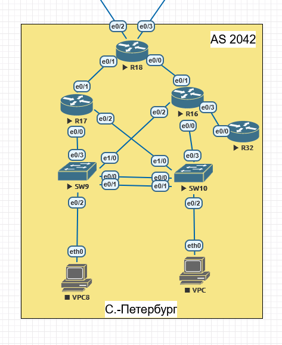

# Настроить EIGRP named-mode для IPv4 и IPv6 в офисе С.-Петербург.
##  Задание:

 1. В офисе С.-Петербург настроить EIGRP.
 2. R32 получает только маршрут по умолчанию.
 3. R16-17 анонсируют только суммарные префиксы
 4. Использовать EIGRP named-mode для настройки сети.
  


## Топология:
- **AS 2042**: С.-Петербург
  

## Адресация: Устройств Используемых в данном Примере

#### Таблица адресации сетевых устройств "С.-Петербург (AS 2042)":
| Устройство    | Интерфейс    | IP-адресс          |
|--------------:|:-------------|-------------------:|
| R16           | loopback     | 10.21.37.8/32      | 
| R16           | e0/0.21      | 10.21.14.1/29      | 
| R16           | e0/1.22      | 10.21.14.129/29    | 
| R16           | e0/2.24      | 10.21.14.193/29    | 
| R16           | e0/2.12      | 10.21.144.33/26    | 
| R16           | e0/3.23      | 10.21.14.65/29     | 
| R17           | loopback     | 10.21.37.9/32      | 
| R17           | e0/0.24      | 10.21.14.194/29    | 
| R17           | e0/1.23      | 10.21.14.66/29     | 
| R17           | e0/2.12      | 10.21.144.34/26    | 
| R17           | e0/2.21      | 10.21.14.2/29      | 
| R18           | loopback     | 10.21.37.10/32     | 
| R18           | e0/0.22      | 10.21.14.130/29    | 
| R18           | e0/1.23      | 10.21.14.67/29     | 
| R18           | e0/2.24      | 10.21.16.14/30     | 
| R18           | e0/3.21      | 10.21.16.45/30     | 
| R32           | loopback     | 10.21.37.11/32     | 
| R32           | e0/0.23      | 10.21.14.68/29     | 
| SW9           | Vlan 37      | 10.37.2.2/24       | 
| SW9           | Vlan 24      | 10.21.14.196/29    | 
| SW10          | Vlan 37      | 10.37.2.3/24       | 
| SW10          | Vlan 21      | 10.21.14.4/29      | 
| VPC8          | Vlan 12      | 10.21.144.35/26    | 
| VPC           | Vlan 12      | 10.21.144.36/26    |  
  

## Принятые решения

| Параметр | Значение | Обоснование |
|:---------|:---------|:------------|
| Режим EIGRP | named-mode, процесс `SPB` | Требование задания 4 |
| Номер AS | 2042 | AS офиса С.-Петербург |
| Router-ID | адрес loopback | Стабильный идентификатор, удобен при диагностике |
| `passive-interface default` | включён | Соседства только на нужных интерфейсах |
| Суммаризация R16, R17 | `10.21.14.0/24`, `10.21.144.0/24`, `10.21.37.0/24` | Требование задания 3 |
| Маршрут по умолчанию для R32 | `summary-address 0.0.0.0 0.0.0.0` на `e0/3.23` R16 | Требование задания 2 |
| Внешние линки R18 (`10.21.16.x/30`) | не входят в EIGRP | Не попадают под `network`, интерфейсы пассивные |
| Коммутаторы SW9, SW10 | EIGRP не используется | Работают на L2, SVI только для управления |

## Конфигурация

### R16

```
router eigrp SPB
 address-family ipv4 unicast autonomous-system 2042
  af-interface default
   passive-interface
  exit-af-interface
  !
  af-interface Ethernet0/0.21
   no passive-interface
   summary-address 10.21.14.0 255.255.255.0
   summary-address 10.21.37.0 255.255.255.0
  exit-af-interface
  af-interface Ethernet0/1.22
   no passive-interface
   summary-address 10.21.14.0 255.255.255.0
   summary-address 10.21.37.0 255.255.255.0
  exit-af-interface
  af-interface Ethernet0/2.24
   no passive-interface
   summary-address 10.21.14.0 255.255.255.0
   summary-address 10.21.37.0 255.255.255.0
  exit-af-interface
  af-interface Ethernet0/2.12
   no passive-interface
   summary-address 10.21.144.0 255.255.255.0
   summary-address 10.21.37.0 255.255.255.0
  exit-af-interface
  af-interface Ethernet0/3.23
   no passive-interface
   summary-address 0.0.0.0 0.0.0.0
  exit-af-interface
  !
  topology base
  exit-af-topology
  network 10.21.14.0 0.0.0.255
  network 10.21.144.0 0.0.0.255
  network 10.21.37.8 0.0.0.0
  eigrp router-id 10.21.37.8
 exit-address-family
```

### R17

```
router eigrp SPB
 address-family ipv4 unicast autonomous-system 2042
  af-interface default
   passive-interface
  exit-af-interface
  !
  af-interface Ethernet0/0.24
   no passive-interface
   summary-address 10.21.14.0 255.255.255.0
   summary-address 10.21.37.0 255.255.255.0
  exit-af-interface
  af-interface Ethernet0/1.23
   no passive-interface
   summary-address 10.21.14.0 255.255.255.0
   summary-address 10.21.37.0 255.255.255.0
  exit-af-interface
  af-interface Ethernet0/2.12
   no passive-interface
   summary-address 10.21.144.0 255.255.255.0
   summary-address 10.21.37.0 255.255.255.0
  exit-af-interface
  af-interface Ethernet0/2.21
   no passive-interface
   summary-address 10.21.14.0 255.255.255.0
   summary-address 10.21.37.0 255.255.255.0
  exit-af-interface
  !
  topology base
  exit-af-topology
  network 10.21.14.0 0.0.0.255
  network 10.21.144.0 0.0.0.255
  network 10.21.37.9 0.0.0.0
  eigrp router-id 10.21.37.9
 exit-address-family
```

### R18

```
router eigrp SPB
 address-family ipv4 unicast autonomous-system 2042
  af-interface default
   passive-interface
  exit-af-interface
  af-interface Ethernet0/0.22
   no passive-interface
  exit-af-interface
  af-interface Ethernet0/1.23
   no passive-interface
  exit-af-interface
  !
  topology base
  exit-af-topology
  network 10.21.14.0 0.0.0.255
  network 10.21.37.10 0.0.0.0
  eigrp router-id 10.21.37.10
 exit-address-family
```

### R32

VLAN 23 общий для R16, R17, R18 и R32, поэтому R17 тоже отправляет в него суммарный префикс. Входящий prefix-list гарантирует, что R32 примет только маршрут по умолчанию.

```
ip prefix-list ONLY-DEFAULT seq 5 permit 0.0.0.0/0

router eigrp SPB
 address-family ipv4 unicast autonomous-system 2042
  af-interface default
   passive-interface
  exit-af-interface
  af-interface Ethernet0/0.23
   no passive-interface
  exit-af-interface
  !
  topology base
   distribute-list prefix ONLY-DEFAULT in Ethernet0/0.23
  exit-af-topology
  network 10.21.14.64 0.0.0.7
  network 10.21.37.11 0.0.0.0
  eigrp router-id 10.21.37.11
 exit-address-family
```

      
## 4. Верификация и тестирование

После применения конфигурации были выполнены следующие проверки (на примере маршрутизатора **R26**) для подтверждения корректной работы протокола.

### 1. Проверка соседств (Adjacencies)

**Команда:** `show isis neighbors`

      R26# show isis neighbors
      Tag TRIADA:
      System Id      Type Interface   IP Address      State Holdtime Circuit Id
      R24            L2   Et0/0.22    10.21.16.21     UP    29       R26.01                                                          
      R25            L2   Et0/2.24    10.21.16.25     UP    24       R26.03

### 2. Проверка базы данных состояний (LSDB)
  
**Команда:** `show isis database`

      R26# show isis database
      Tag TRIADA:
      IS-IS Level-2 Link State Database:
      LSPID                 LSP Seq Num  LSP Checksum  LSP Holdtime      ATT/P/OL
      R23.00-00             0x00000006   0xA3CE        931               0/0/0
      R24.00-00             0x00000005   0xEE26        1122              0/0/0
      R24.03-00             0x00000002   0x923D        660               0/0/0
      R25.00-00             0x00000003   0xCFE9        1140              0/0/0
      R25.01-00             0x00000001   0xA32D        931               0/0/0
      R26.00-00           * 0x00000008   0x298C        1152              0/0/0
      R26.01-00           * 0x00000001   0xB815        1125              0/0/0
      R26.03-00           * 0x00000001   0xBE0C        1143              0/0/0

### 3. Проверка таблицы маршрутизации и связности

**Команда:** `show ip route isis и ping`

      R26#show ip route isis
      Codes: L - local, C - connected, S - static, R - RIP, M - mobile, B - BGP
            D - EIGRP, EX - EIGRP external, O - OSPF, IA - OSPF inter area
            N1 - OSPF NSSA external type 1, N2 - OSPF NSSA external type 2
            E1 - OSPF external type 1, E2 - OSPF external type 2
            i - IS-IS, su - IS-IS summary, L1 - IS-IS level-1, L2 - IS-IS level-2
            ia - IS-IS inter area, * - candidate default, U - per-user static route
            o - ODR, P - periodic downloaded static route, H - NHRP, l - LISP
            a - application route
            + - replicated route, % - next hop override

      Gateway of last resort is not set

            10.0.0.0/8 is variably subnetted, 19 subnets, 2 masks
      i L2     10.21.11.12/30 [115/30] via 10.21.16.25, 00:46:15, Ethernet0/2.24
                              [115/30] via 10.21.16.21, 00:46:15, Ethernet0/0.22
      i L2     10.21.12.8/30 [115/20] via 10.21.16.21, 00:46:33, Ethernet0/0.22
      i L2     10.21.16.4/30 [115/20] via 10.21.16.25, 00:46:15, Ethernet0/2.24
      i L2     10.21.16.8/30 [115/20] via 10.21.16.21, 00:46:33, Ethernet0/0.22
      i L2     10.21.16.12/30 [115/20] via 10.21.16.21, 00:46:33, Ethernet0/0.22
      i L2     10.21.16.32/30 [115/20] via 10.21.16.25, 00:46:15, Ethernet0/2.24
      i L2     10.21.16.40/30 [115/20] via 10.21.16.25, 00:46:15, Ethernet0/2.24
      i L2     10.21.37.13/32 [115/30] via 10.21.16.25, 00:46:15, Ethernet0/2.24


      R26# ping 10.21.37.13 source Loopback0
      Type escape sequence to abort.
      Sending 5, 100-byte ICMP Echos to 10.21.37.13, timeout is 2 seconds:
      !!!!!
      Success rate is 100 percent (5/5), round-trip min/avg/max = 1/1/1 ms

[R23]: conf/base_conf12.md 
[R24]: conf/base_conf13.md  
[R25]: conf/base_conf14.md 
[R26]: conf/base_conf15.md  

