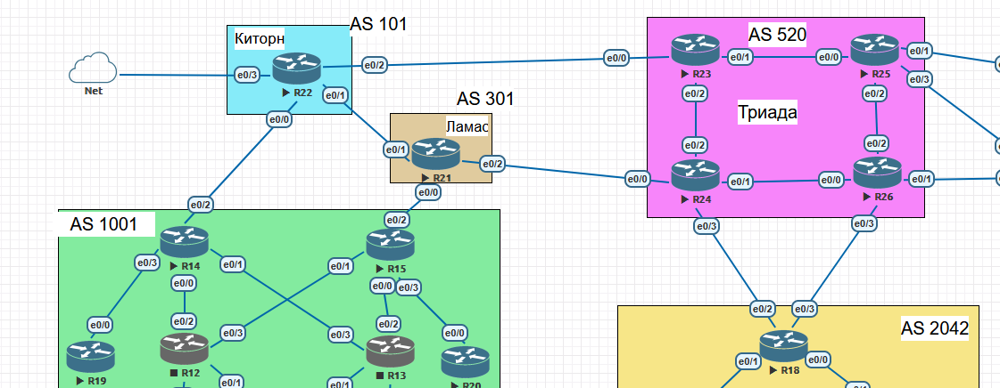

# Настроить BGP между автономными системами и организовать доступность между офисами Москва и С.-Петербург.
##  Задание:

 1. Настроите eBGP между офисом Москва и двумя провайдерами - Киторн и Ламас.   
 2. Настроите eBGP между провайдерами Киторн и Ламас.   
 3. Настроите eBGP между Ламас и Триада.  
 4. Настроите eBGP между офисом С.-Петербург и провайдером Триада.
 5. Организуете IP доступность между пограничным роутерами офисами Москва и С.-Петербург.
  


## Топология:
- **AS 2042**: С.-Петербург
  

| AS | Организация | BGP-роутеры | Роль |
|---|---|---|---|
| 1001 | Москва | R14, R15 | офис, два выхода к провайдерам |
| 2042 | С.-Петербург | R18 | офис, граница к Триаде |
| 101 | Китрон | R22 | провайдер |
| 301 | Ламас | R21 | провайдер |
| 520 | Триада | R24, R26 | провайдер, два выхода к СПб |


## Схема BGP-сессий

```
        AS 1001 Москва
   ┌─────────┴─────────┐
  R14 ═══ iBGP ═══ R15
   │                   │
 eBGP                eBGP
   │                   │
  R22 ─── eBGP ─── R21
 AS 101            AS 301
                     │
                   eBGP
                     │
              ┌── R24 ═ iBGP ═ R26 ──┐        AS 520 Триада
              │                       │
            eBGP                    eBGP
              └────────── R18 ────────┘        AS 2042 СПб
```
## Конфигурация

### Стыки и адреса

| Сессия | Тип | Подсеть | Адреса |
|---|---|---|---|
| R14 – R22 | eBGP 1001–101 | `10.21.13.232/30` | R14 `.233`, R22 `.234` |
| R15 – R21 | eBGP 1001–301 | `10.21.13.236/30` | R15 `.237`, R21 `.238` |
| R22 – R21 | eBGP 101–301 | `10.21.11.0/30` | R21 `.1`, R22 `.2` |
| R21 – R24 | eBGP 301–520 | `10.21.12.8/30` | R24 `.9`, R21 `.10` |
| R24 – R18 | eBGP 520–2042 | `10.21.16.12/30` | R24 `.13`, R18 `.14` |
| R26 – R18 | eBGP 520–2042 | `10.21.16.44/30` | R18 `.45`, R26 `.46` |
| R14 – R15 | iBGP 1001 | Loopback | `10.21.37.4` ↔ `10.21.37.5` |
| R24 – R26 | iBGP 520 | Loopback | `10.21.37.14` ↔ `10.21.37.16` |

### Анонсируемые префиксы

| AS | Префиксы |
|---|---|
| 1001 | `10.21.13.0/24`, `10.21.37.4/32`, `10.21.37.5/32` |
| 2042 | `10.21.14.0/24`, `10.21.37.10/32` |
| 101 | `10.21.37.18/32` |
| 301 | `10.21.37.19/32` |
| 520 | `10.21.37.14/32`, `10.21.37.16/32` |

## Принципы настройки

**1. Агрегаты через Null0.** Команда `network` анонсирует только маршрут, который точно есть в таблице маршрутизации. В офисах множество подсетей, поэтому для агрегата добавлен статический маршрут на `Null0`. Пересылка при этом идёт по более специфичным маршрутам.

**2. Фильтр исходящих анонсов.** Москва и СПб подключены к двум провайдерам, поэтому на выходе стоит `route-map OUT-ISP` с prefix-list. Она пропускает только собственные префиксы. Без неё офис стал бы транзитной AS между провайдерами.

**3. iBGP по Loopback и `next-hop-self`.** R14 и R15 (а также R24 и R26) обмениваются маршрутами по iBGP, сессия строится между Loopback-адресами, чтобы она не зависела от одного физического линка. Для iBGP next-hop по умолчанию не меняется, а внешние next-hop не известны соседу по IGP. Поэтому на iBGP-сессиях включён `next-hop-self`.

**4. Выбор пути.** Из Москвы в СПб BGP выбирает путь с наименьшей длиной AS-path. Путь через Ламас (`301 520 2042`) короче, чем через Китрон (`101 301 520 2042`).

## Конфигурации

### R14 (Москва)

```
ip route 10.21.13.0 255.255.255.0 Null0
ip prefix-list MY-NETS permit 10.21.13.0/24
ip prefix-list MY-NETS permit 10.21.37.4/32
ip prefix-list MY-NETS permit 10.21.37.5/32
route-map OUT-ISP permit 10
 match ip address prefix-list MY-NETS
!
router bgp 1001
 bgp router-id 10.21.37.4
 neighbor 10.21.13.234 remote-as 101
 neighbor 10.21.13.234 route-map OUT-ISP out
 neighbor 10.21.37.5 remote-as 1001
 neighbor 10.21.37.5 update-source Loopback0
 neighbor 10.21.37.5 next-hop-self
 network 10.21.13.0 mask 255.255.255.0
 network 10.21.37.4 mask 255.255.255.255
```

### R15 (Москва)

```
ip route 10.21.13.0 255.255.255.0 Null0
ip prefix-list MY-NETS permit 10.21.13.0/24
ip prefix-list MY-NETS permit 10.21.37.4/32
ip prefix-list MY-NETS permit 10.21.37.5/32
route-map OUT-ISP permit 10
 match ip address prefix-list MY-NETS
!
router bgp 1001
 bgp router-id 10.21.37.5
 neighbor 10.21.13.238 remote-as 301
 neighbor 10.21.13.238 route-map OUT-ISP out
 neighbor 10.21.37.4 remote-as 1001
 neighbor 10.21.37.4 update-source Loopback0
 neighbor 10.21.37.4 next-hop-self
 network 10.21.13.0 mask 255.255.255.0
 network 10.21.37.5 mask 255.255.255.255
```

### R22 (Китрон, AS 101)

```
router bgp 101
 bgp router-id 10.21.37.18
 neighbor 10.21.13.233 remote-as 1001
 neighbor 10.21.11.1 remote-as 301
 network 10.21.37.18 mask 255.255.255.255
```

### R21 (Ламас, AS 301)

```
router bgp 301
 bgp router-id 10.21.37.19
 neighbor 10.21.13.237 remote-as 1001
 neighbor 10.21.11.2 remote-as 101
 neighbor 10.21.12.9 remote-as 520
 network 10.21.37.19 mask 255.255.255.255
```

### R24 (Триада, AS 520)

```
router bgp 520
 bgp router-id 10.21.37.14
 neighbor 10.21.12.10 remote-as 301
 neighbor 10.21.16.14 remote-as 2042
 neighbor 10.21.37.16 remote-as 520
 neighbor 10.21.37.16 update-source Loopback0
 neighbor 10.21.37.16 next-hop-self
 network 10.21.37.14 mask 255.255.255.255
```

### R26 (Триада, AS 520)

```
router bgp 520
 bgp router-id 10.21.37.16
 neighbor 10.21.16.45 remote-as 2042
 neighbor 10.21.37.14 remote-as 520
 neighbor 10.21.37.14 update-source Loopback0
 neighbor 10.21.37.14 next-hop-self
 network 10.21.37.16 mask 255.255.255.255
```

### R18 (С.-Петербург, AS 2042)

```
ip route 10.21.14.0 255.255.255.0 Null0
ip prefix-list MY-NETS permit 10.21.14.0/24
ip prefix-list MY-NETS permit 10.21.37.10/32
route-map OUT-ISP permit 10
 match ip address prefix-list MY-NETS
!
router bgp 2042
 bgp router-id 10.21.37.10
 neighbor 10.21.16.13 remote-as 520
 neighbor 10.21.16.13 route-map OUT-ISP out
 neighbor 10.21.16.46 remote-as 520
 neighbor 10.21.16.46 route-map OUT-ISP out
 network 10.21.14.0 mask 255.255.255.0
 network 10.21.37.10 mask 255.255.255.255
```

## Проверка

### Состояние сессий

```
show ip bgp summary
```

| Роутер | Ожидаемые соседи в `Established` |
|---|---|
| R14 | R22, R15 |
| R15 | R21, R14 |
| R22 | R14, R21 |
| R21 | R15, R22, R24 |
| R24 | R21, R18, R26 |
| R26 | R24, R18 |
| R18 | R24, R26 |

### AS-path к ключевым префиксам

| Откуда | Префикс | AS-path |
|---|---|---|
| R15 (Москва) | `10.21.37.10/32` (R18) | `301 520 2042` |
| R14 (Москва) | `10.21.37.10/32` (R18) | `101 301 520 2042` (до установления iBGP; после — через R15) |
| R18 (СПб) | `10.21.13.0/24` (Москва) | `520 301 1001` |
| R18 (СПб) | `10.21.37.5/32` (R15) | `520 301 1001` |
| R21 (Ламас) | `10.21.14.0/24` (СПб) | `520 2042` |

### Доступность между пограничными роутерами

```
R14# ping 10.21.37.10 source Loopback0
R15# ping 10.21.37.10 source Loopback0
R18# ping 10.21.37.4  source Loopback0
```

| Проверка | Результат |
|---|---|
| R14 → R18 | 5/5 |
| R15 → R18 | 5/5 |
| R18 → R14 | 5/5 |

Для проверки BGP пинг выполняется только с Loopback, так как подсети стыков в BGP не анонсируются и обратный путь для них не существует.
